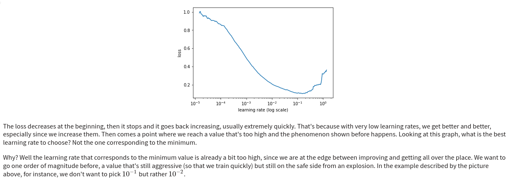

# LR Finder

## Goal

We want to find a proper learning rate range for our training.

The idea is to start training the model by progressively increasing the learning rate and to report the loss value.

The best learning rate value should be **one order of magnitude lower than the one corresponding to the minimum loss value**.


<center><em>Extract from Gruggers'post</em></center>


## Credits 

This idea comes from the paper by Smith: [Cyclical Learning Rates for Training Neural Networks (2017)](https://arxiv.org/pdf/1506.01186).

The algorithm implemented here comes from Grugger's post: [How Do You Find a Good Learning Rate? (2018)](https://sgugger.github.io/how-do-you-find-a-good-learning-rate.html).


## Context

* Model: ResNet-18
* Dataset: CIFAR-10

## Usage

### Generate a CSV file containing the loss values for a series of learning rates
```sh
python cifar10_Grugger_lrfinder.py \
				--nepochs 100 \
				--batch-size 256 \
				--optim 'SGD' \
				--min-lr 1e-5 \
				--max-lr 1e0 \
				--mom 0.9 \
				--wd 0.0
```

with:
* `nepochs` the number of epochs to run. This parameter controls the number of learning rate values that will be tested from `min_lr` to `max_lr`. `nepochs` x `nsteps` iterations will be performed (unless the loss explodes). *Default: `nepochs=100`*.
* `batch_size` the batch size. *Default `batch_size=256`*.
* `optim` the optimizer, which can be either 'SGD' or 'AdamW'. *Default: `optim='SGD'`*.
* `min_lr` the minimum learning rate value to test. *Default: `min_lr=1e-5`*.
* `max_lr` the maximum learning rate value to test. *Default: `max_lr=1e0`*.
* `mom` the momentum value. *Default: `mom=0.9`*.
* `wd` the weight decay value. *Default: `wd=0.`*.

**CSV output**: `lrfinder_<optim>_<batch_size>_<min_lr>_<max_lr>_<mom>_<wd>_<nepochs>_<jobid>.csv`

### Plot graph

```sh
python plot_lrfinder.py -f <csv_filename>
```

**JPG output**: `lrfinder_<optim>_<batch_size>_<min_lr>_<max_lr>_<mom>_<wd>_<nepochs>_<jobid>.jpg`

